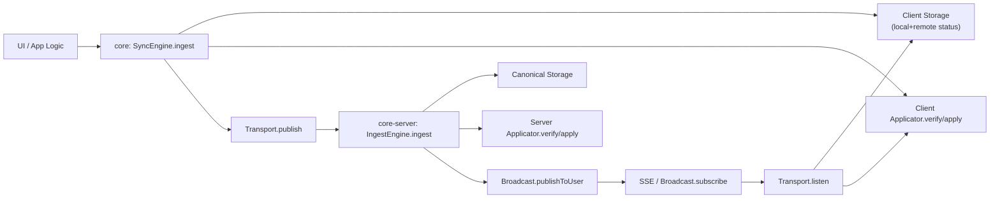

# Groundswell

Groundswell is a TypeScript monorepo for building event-driven, eventually-consistent synchronization between local clients and a canonical server.

It is organized as small, composable packages:

- Core runtime contracts and orchestration
- Server-side ingest and broadcast orchestration
- Transport and framework adapters
- Storage adapters
- React integration helpers
- Zod helpers for domain event schemas

## Package Matrix

| Package                                                                                  | Purpose                                                     |
| ---------------------------------------------------------------------------------------- | ----------------------------------------------------------- |
| [`@groundswell/core`](./packages/core/README.md)                                         | Client sync engine (`SyncEngine`) and applicator helpers    |
| [`@groundswell/core-server`](./packages/core-server/README.md)                           | Server ingest engine (`IngestEngine`) contracts and runtime |
| [`@groundswell/adapter-sse-client`](./packages/adapter-sse-client/README.md)             | Client transport using HTTP + SSE                           |
| [`@groundswell/adapter-hono-server`](./packages/adapter-hono-server/README.md)           | Hono server endpoints for sync ingest/stream                |
| [`@groundswell/adapter-bun-server`](./packages/adapter-bun-server/README.md)             | Bun route handlers for sync ingest/stream                   |
| [`@groundswell/adapter-drizzle-sqlite`](./packages/adapter-drizzle-sqlite/README.md)     | SQLite storage adapters (client + canonical)                |
| [`@groundswell/adapter-drizzle-postgres`](./packages/adapter-drizzle-postgres/README.md) | PostgreSQL canonical storage adapter                        |
| [`@groundswell/react`](./packages/react/README.md)                                       | React provider/hooks for running a sync engine              |
| [`@groundswell/zod-helpers`](./packages/zod-helpers/README.md)                           | Zod helpers for domain-event schema definitions             |

## Architecture At A Glance

Groundswell uses domain events as the synchronization primitive.



Detailed architecture docs:

- [Architecture Overview](./docs/architecture/overview.md)
- [Event Lifecycle](./docs/architecture/event-lifecycle.md)
- [HTTP + SSE Contract](./docs/reference/http-and-sse-contract.md)

## Quick Start

### Prerequisites

- [Bun](https://bun.sh)
- TypeScript-compatible toolchain (workspace uses TypeScript and Effect)

### Install

```bash
bun install
direnv allow            # optional, if you use Nix + direnv
bunx lefthook install   # optional, install local git hooks
```

### Common Tasks

```bash
bun run build
bun run checks:hygiene
bun run checks:fmt:ci
bun run checks:lint
bun run test
```

Helpful local shortcuts:

```bash
just check
just qa
```

GitHub Actions runs formatter, lint-with-type-checking, tests, and builds on push and pull request.

## Local effect-drizzle Integration

Groundswell uses a committed local tarball flow for `@schnau/effect-drizzle`.
Use this workflow only; avoid ad-hoc nested installs in `examples/basic-react-app/node_modules`.

```bash
bun run local:effect-drizzle:sync
bun run local:effect-drizzle:verify
bun run checks:hygiene
```

If you are already in `/Users/haukeschnau/urbs/Libraries/effect-drizzle` and only want to repack:

```bash
bun run pack:local
```

Detailed troubleshooting guide:

- [`docs/contributing/local-effect-drizzle.md`](./docs/contributing/local-effect-drizzle.md)

## Example App

A runnable end-to-end integration lives in:

- [`examples/basic-react-app`](./examples/basic-react-app/README.md)

It wires:

- `@groundswell/core` + `@groundswell/react`
- `@groundswell/core-server`
- `@groundswell/adapter-bun-server`
- `@groundswell/adapter-sse-client`
- `@groundswell/adapter-drizzle-sqlite`

## Repository Layout

- `packages/*` — publishable libraries
- `examples/*` — runnable integration examples
- `docs/*` — architecture, reference, and contributor documentation
- `scripts/*` — release tooling
- `patches/*` — patched dependency overrides

## Documentation Map

Start here for docs navigation:

- [`docs/README.md`](./docs/README.md)

## Assumptions and Current Boundaries

Current docs describe behavior as implemented in this repository today. Notable boundaries:

- Serialization in adapters is currently based on `superjson`.
- Server adapters expose `POST /events` and `GET /events` contracts.
- Core retry behavior is defined in `@groundswell/core` transport publish flow.
- Storage adapters define specific schema/table expectations.
