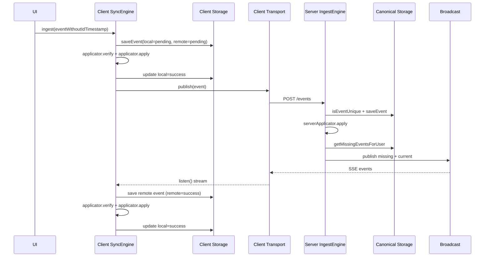
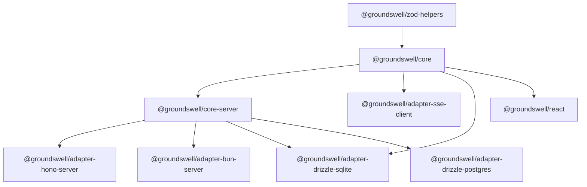

# Architecture Overview

Groundswell is a layered synchronization system built around domain events.

## Goals

- Keep local user interactions fast by applying events locally first.
- Preserve a canonical server history for validation, fan-out, and catch-up.
- Model sync state explicitly (`pending`, `success`, `error`) for local and remote phases.
- Compose implementations with Effect services (Applicator, Storage, Transport, Broadcast).

## Core Building Blocks

### Client Side (`@groundswell/core`)

- `SyncEngine` orchestrates ingest, local apply, remote publish, and inbound remote processing.
- `Applicator` provides domain-specific `verify` and `apply` logic.
- `Storage` persists local events and sync status.
- `Transport` publishes local events and listens for remote events.

### Server Side (`@groundswell/core-server`)

- `IngestEngine` orchestrates canonical ingest.
- `ServerApplicator` provides server validation/apply and topic derivation.
- `CanonicalStorage` persists canonical events and delivery metadata.
- `Broadcast` delivers per-user streams.

## High-Level Flow

## Event Status Model

Client events are tracked as:

- `local`: `pending` | `success` | `error`
- `remote`: `pending` | `success` | `error`

This model allows:
- Local-first UX while remote sync is still pending
- Explicit retry/error signaling for network problems
- Deterministic startup replay of unfinished work

## Serialization and Validation

- Adapters currently serialize wire/storage payloads with `superjson`.
- Domain event validity is enforced through `zod` schemas in adapters.
- Runtime validation errors surface as typed Effect errors (`ValidationError`, `TransportError`, `StorageError`, etc.).

## Package Dependencies (Conceptual)

## Known Architectural Constraints

- Server adapters have slightly different HTTP status mapping in some error paths.
- SSE adapters do not currently expose heartbeats or explicit event IDs in transport contracts.
- Canonical duplicate checking uses a read-then-write pattern; DB constraints remain the final guard.

## Where To Go Next

- For end-to-end request/stream contract details, see [HTTP + SSE Contract](../reference/http-and-sse-contract.md).
- For package-by-package details, see [Package Map](./package-map.md).
